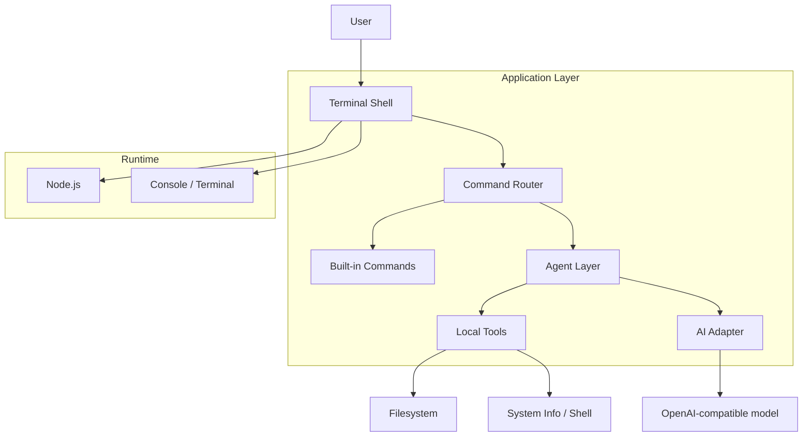

# Architecture Overview

This project is an interactive AI terminal that combines a local command shell with a lightweight agent layer. It is designed to respond to user prompts, run local filesystem commands, and optionally forward requests to an OpenAI-compatible API.

## Components

- `src/index.js`
  - Bootstraps the terminal session.

- `src/terminal.js`
  - Owns the interactive prompt, history, and color output.

- `src/commands.js`
  - Houses the built-in CLI commands and agent command handlers.

- `src/ai.js`
  - Talks to the OpenAI-compatible API.

- `src/tools.js`
  - Exposes filesystem and environment tools used by the agent.

- `src/agent.js`
  - Coordinates task execution and decides whether to use local tools or AI.

## Runtime Flow

1. The user types a command at the terminal prompt.
2. The shell resolves the command name via the registry.
3. Built-in commands execute locally in Node.js.
4. The `ask` command and `agent` command may call the AI provider.
5. Tool-backed prompts can inspect the filesystem or query system information.
6. Results are printed to the terminal and added to the command history.
