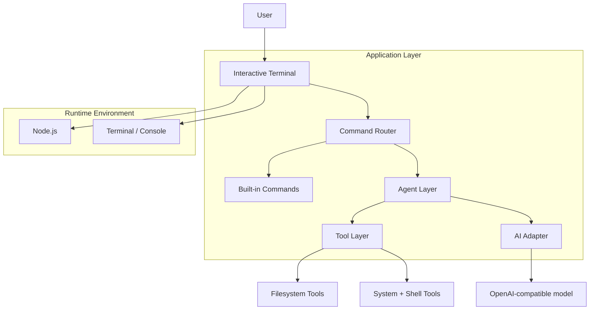

# AI Terminal

A terminal-first AI agent that combines a local command shell with OpenAI-compatible AI assistance and built-in tool execution.

## Components

- `src/index.js`
  - Starts the terminal session.

- `src/terminal.js`
  - Manages the readline loop, prompt display, history, and command execution.

- `src/commands.js`
  - Defines built-in commands and command dispatch behavior.

- `src/agent.js`
  - Coordinates the agent flow and exposes tool execution.

- `src/tools.js`
  - Exposes filesystem and system helper functions.

- `src/ai.js`
  - Performs AI requests using the OpenAI API format.

## Runtime Flow

1. The user types a command.
2. The terminal parses the input and resolves the matching command.
3. Built-in commands run locally in Node.js.
4. The `ask` command sends a prompt to the AI provider.
5. The `agent` command uses instructions and tool context to decide how to respond.
6. Tool-backed requests can read files, inspect directories, or run shell commands.
7. Output is printed to the terminal and saved to command history.
