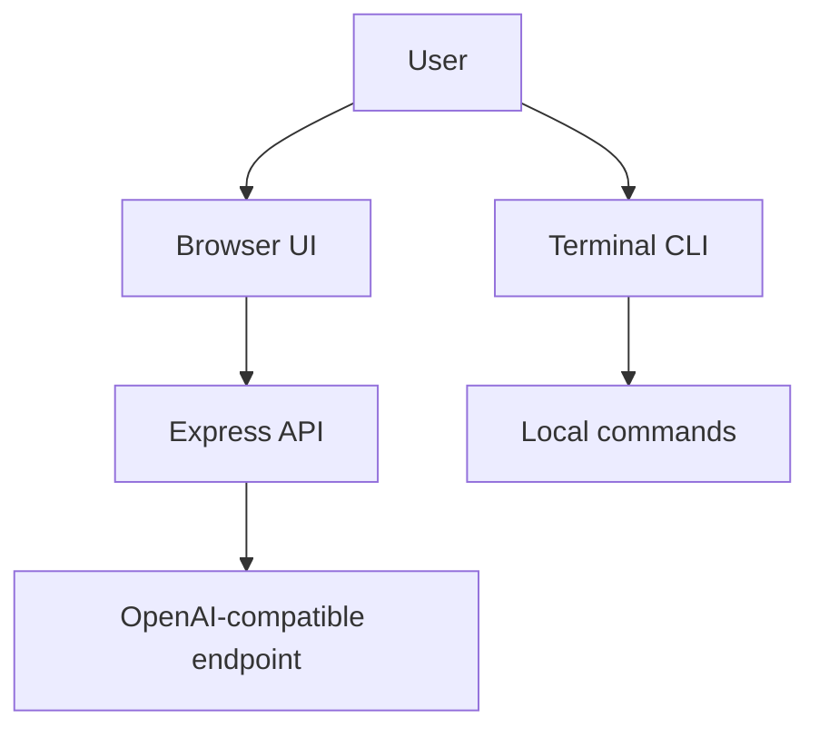

# Architecture Overview

This project is a lightweight AI terminal application with a browser-based interface and a command-line fallback. It combines a simple Express app with a local CLI shell and an OpenAI-compatible chat endpoint.

## High-level flow

## Components

- `server.js` starts the web app and chat endpoint
- `public/` contains the browser interface
- `src/terminal.js` runs the CLI shell
- `src/commands.js` defines terminal commands
- `src/ai.js` handles AI requests
- `src/tools.js` exposes helper utilities for filesystem/system behavior

## Deployment modes

- local web app via `npm start`
- local CLI via `npm run cli`
- Docker via `docker build` / `docker compose`
