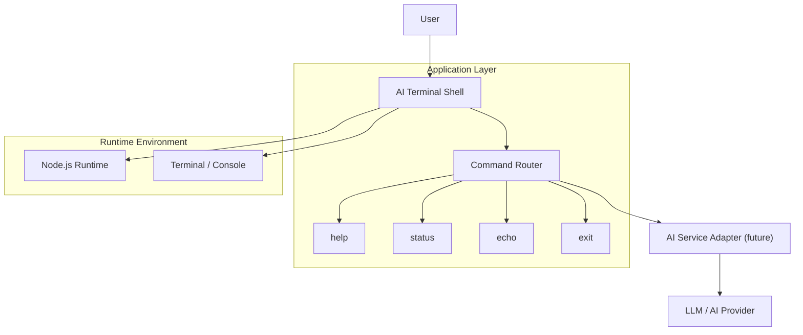

# Architecture Overview

This project is a terminal-focused application skeleton for AI-powered workflows. It is intentionally simple: a CLI entry point, a command registry, and a shell-like session loop that can later be connected to real AI providers or local models.

## Components

- `src/index.js`
  - Application entry point.
  - Starts the terminal session and manages the interactive loop.

- `src/terminal.js`
  - Handles input/output operations.
  - Reads user commands and prints responses.

- `src/commands.js`
  - Central registry for supported commands.
  - Keeps command logic isolated and easy to extend.

- `.env.example`
  - Template for environment configuration.
  - Useful when connecting to external AI APIs.

## Runtime Flow

1. The terminal starts in the console.
2. The user enters a command.
3. The command router matches it to a built-in handler.
4. The system prints a result in the terminal.
5. Future integrations can route the command to an AI model or external service.
