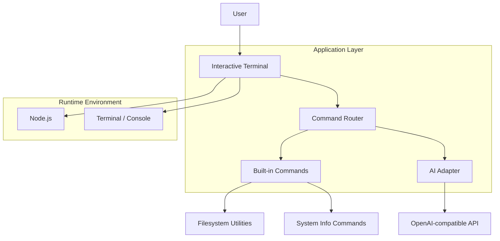

# Architecture Overview

This project is a terminal-based AI shell designed to be easy to extend. It combines a command router, a user-facing interactive prompt, and a pluggable AI adapter so the app can answer natural-language questions or execute built-in CLI operations.

## Components

- `src/index.js`
  - Bootstraps the terminal session.

- `src/terminal.js`
  - Manages prompt lifecycle and input processing.
  - Tracks command history and emits colored output.

- `src/commands.js`
  - Stores the built-in commands.
  - Includes help, status, echo, ls, pwd, date, history, clear, ask, and exit.

- `src/ai.js`
  - Sends prompts to an OpenAI-compatible API using environment variables.
  - Produces AI responses for the terminal shell.

- `.env.example`
  - Provides the configuration template for API credentials.

## Runtime Flow

1. The terminal starts and prints the prompt.
2. The user enters a command.
3. The command router resolves the command name.
4. Built-in commands execute locally in Node.js.
5. The `ask` command forwards the prompt to the AI provider.
6. Output is printed to the console, and command history is updated.
